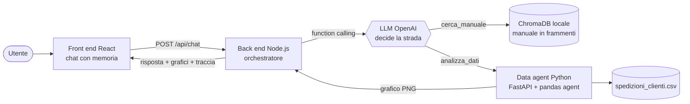
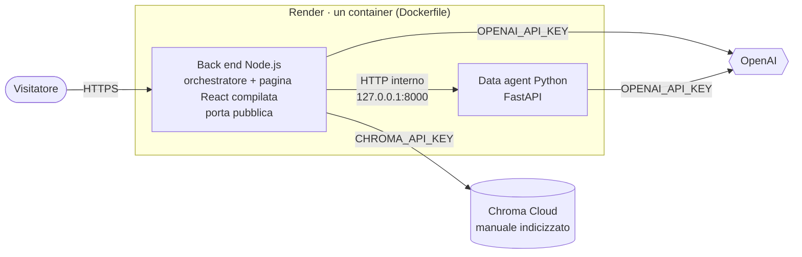

# SupplyBot – agente AI ibrido per la Supply Chain di Atisale

SupplyBot è un assistente conversazionale per il reparto Supply Chain di un produttore di sale marino. Da un'unica chat risponde a due tipi di domande e **decide da solo** quale strada prendere:

- **regole e procedure** (priorità degli ordini, soglie di puntualità, gestione dei reclami) → cerca nel *Manuale Operativo Supply Chain* con una **RAG su ChromaDB**;
- **numeri e andamenti** (volumi stagionali, puntualità dei vettori, ritardi) → delega a un **data agent Python** che pulisce il dataset, scrive ed esegue codice pandas e genera grafici;
- **domande ibride** (es. "quali vettori sono sotto l'obiettivo del manuale?") → prima legge la regola nel manuale, poi la passa al data agent per verificarla sui dati.

> **Prova l'app online:** <https://supplybot-atisale.onrender.com>
> È ospitata sul piano gratuito di Render: dopo 15 minuti senza visite il servizio si addormenta e la prima apertura può richiedere circa un minuto. Le analisi con grafico sono più lente che in locale (CPU ridotta). Per proteggere i costi ogni visitatore può fare al massimo 20 domande all'ora.

> **Avviso.** Progetto didattico. Il caso è ispirato ad **Atisale S.p.A.** solo per i fatti pubblici (le saline di Margherita di Savoia e Sant'Antioco, le linee di prodotto). Manuale, dataset, clienti, vettori, volumi e soglie sono **simulati** e non descrivono l'organizzazione reale dell'azienda.

---

## Architettura



| Servizio | Cartella | Tecnologia | Porta |
| --- | --- | --- | --- |
| Interfaccia | `frontend/` | React 19 + Vite | 5173 |
| Orchestratore | `backend/` | Node.js 20+, Express, SDK OpenAI, client ChromaDB | 3001 |
| Database vettoriale | `backend/chroma_db/` (creato all'avvio) | ChromaDB in locale | 8001 |
| Analisi dati | `data_agent/` | Python, FastAPI, pandas, matplotlib | 8000 |

**Come decide.** Il back end implementa un ciclo ReAct (*Reason + Act*) con il function calling nativo dell'SDK OpenAI. A ogni domanda l'LLM riceve due strumenti, `cerca_manuale` e `analizza_dati`, e sceglie quale chiamare (anche entrambi, in sequenza). Ne osserva il risultato e decide se ha abbastanza informazioni per rispondere. Ogni risposta arriva al front end con la **traccia delle decisioni**: quali strumenti, con quali input, quali capitoli del manuale, quale codice è stato eseguito. Il flusso è quindi verificabile.

### Architettura degli agenti: orchestratore e specialista

SupplyBot è un sistema **gerarchico a due agenti**. Per agente si intende un LLM che ragiona in un ciclo (decide, usa uno strumento, osserva il risultato, decide di nuovo); uno strumento invece esegue senza decidere.

| Componente | Ruolo | Agente? |
| --- | --- | --- |
| Orchestratore (`backend/`) | Parla con l'utente, tiene la memoria della conversazione, sceglie la strada | **Sì**: LLM con ciclo ReAct e due strumenti |
| Data agent (`data_agent/`) | Valida e pulisce i dati (una volta, all'avvio), scrive ed esegue codice pandas, genera grafici | **Sì**: un secondo LLM con il proprio ciclo ReAct e il proprio strumento (`esegui_python`) |
| RAG su ChromaDB | Restituisce i paragrafi del manuale più pertinenti | **No**: strumento di recupero, senza LLM |

Il modello è quello **orchestratore–specialista** (*agent as a tool*): l'orchestratore usa il data agent come uno dei suoi strumenti, gli affida un compito completo e ne riceve il risultato. La comunicazione è a senso unico: il data agent non vede la conversazione e non parla con l'utente, per cui l'orchestratore riformula le domande di seguito in domande autonome.

Perché due agenti e non uno:

- **separazione dei contesti**: l'orchestratore ragiona su conversazione e regole, il data agent su colonne, codice ed errori di pandas;
- **sicurezza**: il codice generato viene eseguito solo nel servizio Python isolato, mai nell'orchestratore;
- **modelli indipendenti**: il data agent può usare un modello più adatto al codice (`OPENAI_MODEL_DATA`) senza cambiare quello dell'orchestratore;
- **coerenza con l'architettura a microservizi** richiesta: ogni agente vive nel proprio servizio.

Non è un sistema multi-agente "alla pari": è volutamente il minimo indispensabile, un orchestratore e un solo specialista, perché ogni agente in più aggiunge costi, latenza e punti di errore.

---

## Prerequisiti

- **Windows 10/11** (le istruzioni manuali valgono anche per macOS e Linux)
- **Python 3.10 – 3.13**
- **Node.js 20** o superiore
- Una **chiave API di OpenAI**

## Installazione

### Metodo rapido (Windows; su macOS/Linux `./installa.sh`)

1. Clona il repository e apri la cartella:
   ```bat
   git clone https://github.com/GMaffione/supplybot-atisale.git
   cd supplybot-atisale
   ```
2. Esegui **`installa.bat`**: crea l'ambiente Python `.venv`, installa le dipendenze dei tre servizi e crea il file `.env` da `.env.example`.
3. Apri `.env` e inserisci la tua chiave in `OPENAI_API_KEY`.

### Metodo manuale

```bat
REM 1. Ambiente Python (data agent + ChromaDB)
python -m venv .venv
.venv\Scripts\activate
pip install -r data_agent\requirements.txt

REM 2. Back end Node
cd backend
npm install
cd ..

REM 3. Front end React
cd frontend
npm install
cd ..

REM 4. Variabili d'ambiente
copy .env.example .env
REM ...poi inserisci la chiave in .env
```

Su macOS/Linux: `source .venv/bin/activate` al posto di `.venv\Scripts\activate` e `cp` al posto di `copy`.

## Avvio

### Metodo rapido (Windows; su macOS/Linux `./avvia.sh`)

Esegui **`avvia.bat`**: apre una finestra per ogni servizio, nell'ordine giusto, e poi il browser su <http://localhost:5173>. Per fermare tutto chiudi le quattro finestre.

### Metodo manuale – quattro terminali, in quest'ordine

| # | Servizio | Comando (dalla radice del progetto, con `.venv` attivo) |
| --- | --- | --- |
| 1 | ChromaDB | `chroma run --path backend/chroma_db --port 8001` |
| 2 | Data agent | `cd data_agent` e poi `python -m uvicorn app:app --port 8000` |
| 3 | Back end | `cd backend` e poi `npm start` |
| 4 | Front end | `cd frontend` e poi `npm run dev` |

Poi apri <http://localhost:5173>. In alto a destra due indicatori mostrano se *Manuale* (ChromaDB) e *Dati* (data agent) sono raggiungibili.

Al primo avvio il back end **indicizza da solo il manuale** in ChromaDB (29 frammenti). Per reindicizzarlo da zero, ad esempio dopo averlo modificato: `cd backend` e poi `npm run ingest`.

---

## Versione online (deploy)

L'app è pubblicata su **Render** (piano gratuito) con l'indice del manuale su **Chroma Cloud**. Il codice è lo stesso della versione locale: cambiano solo le variabili d'ambiente.



| | In locale | Online |
|---|---|---|
| Front end | Vite su :5173, inoltra `/api` al back end | pagina React compilata, servita dal back end: un solo indirizzo |
| Back end e data agent | due processi sul PC | due processi nello **stesso container**, che comunicano via HTTP come in locale; il data agent non è raggiungibile dall'esterno |
| ChromaDB | server locale (`chroma run`) | **Chroma Cloud**: si attiva da solo se è impostata `CHROMA_API_KEY` |
| Chiavi | file `.env` | variabili d'ambiente del servizio su Render |

**Perché un solo container.** Il piano gratuito di Render offre servizi da 512 MB che si addormentano dopo 15 minuti, e non permette a un servizio gratuito di riceverne un altro sulla rete privata. Con due servizi separati il data agent sarebbe stato pubblico e i "risvegli" si sarebbero sommati. Nello stesso container i due processi restano separati (stessa architettura a microservizi), consumano circa 400 MB e si svegliano insieme.

**Protezione dei costi** (l'app è pubblica e usa la chiave del progetto), in `backend/src/limiti.js` e `config.js`:
- massimo 20 domande all'ora per visitatore e 300 al giorno in totale (`LIMITE_DOMANDE_ORA`, `LIMITE_DOMANDE_GIORNO`);
- domande di massimo 1.000 caratteri;
- timeout sulle chiamate a OpenAI (60 s nel back end, 90 s nel data agent) e un solo nuovo tentativo;
- al massimo 500 conversazioni in memoria;
- consigliato anche un tetto di spesa mensile sul progetto OpenAI.

### Come pubblicarla (una sola volta)

1. **Chroma Cloud**: crea un database (es. `supplybot`) e una API key. Annota API key, tenant e nome del database.
2. **Render**: *New → Blueprint*, collega questo repository. Render legge `render.yaml` e chiede le quattro chiavi: `OPENAI_API_KEY`, `CHROMA_API_KEY`, `CHROMA_TENANT`, `CHROMA_DATABASE`.
3. Al primo avvio il back end indicizza il manuale su Chroma Cloud (29 frammenti); dagli avvii successivi lo trova già pronto.
4. Ogni `git push` sul ramo `main` ripubblica l'app automaticamente.

## Domande di esempio

| Strada | Domanda |
| --- | --- |
| Manuale (RAG) | Un comune chiede sale da disgelo per un'allerta neve: entro quanto va servito? |
| Manuale (RAG) | Come si gestisce un reclamo per sacchi rotti? |
| Dati + grafico | Come sono andati i volumi di sale da disgelo nell'inverno 2025-26, mese per mese? |
| Dati + grafico | Le spedizioni via nave da Sant'Antioco sono meno puntuali d'inverno? |
| Ibrida | Quali vettori sono sotto l'obiettivo di puntualità previsto dal manuale? |
| Ibrida | Quanto sale da disgelo dobbiamo avere a scorta entro il 31 ottobre? |
| Memoria | (dopo la domanda sui vettori) E per le spedizioni da Sant'Antioco? |

---

## Struttura del repository

```
supplybot/
├── frontend/                 Interfaccia React (chat, indicatore di attesa, grafici, traccia)
│   └── src/App.jsx, styles.css
├── backend/                  Orchestratore Node.js
│   └── src/
│       ├── server.js         Endpoint /api/chat, /api/charts, /api/health, /api/reset, /api/ping
│       ├── orchestrator.js   Prompt di sistema, strumenti, ciclo ReAct, memoria delle sessioni
│       ├── rag.js            PDF -> frammenti -> embedding -> ChromaDB; ricerca semantica
│       ├── ingest.js         Reindicizzazione manuale del manuale
│       ├── dataAgent.js      Client HTTP verso il servizio Python
│       ├── limiti.js         Limiti di domande per visitatore e al giorno (versione online)
│       ├── validazione.js    Schemi zod delle richieste in ingresso
│       ├── cache.js          Cache LRU con scadenza (risposte e ricerche nel manuale)
│       ├── logger.js         Log JSON e request_id (AsyncLocalStorage)
│       └── config.js         Lettura del file .env / variabili d'ambiente
├── data_agent/               Microservizio Python
│   ├── app.py                FastAPI: /analyze, /charts/{nome}, /health
│   ├── agente_dati.py        Pandas agent: ciclo ReAct con autocorrezione
│   ├── dataset.py            Dataset letto, validato e pulito una volta all'avvio
│   ├── schema.py             Contratto dei dati: colonne, tipi, valori ammessi, formati
│   ├── cache.py              Cache delle analisi gia' eseguite
│   ├── registro.py           Log JSON con request_id
│   ├── pulizia.py            Regole di pulizia del dataset, con report delle correzioni
│   ├── sandbox.py            Controllo ed esecuzione isolata del codice generato
│   ├── _runner.py            Processo figlio che esegue il codice
│   ├── prototipo_data_agent.ipynb   Notebook di prototipazione in modalità verbose
│   ├── requirements-server.txt   Librerie del solo servizio (usate anche online)
│   └── requirements.txt          Installazione locale completa (servizio + ChromaDB + notebook)
├── data/
│   ├── spedizioni_clienti.csv        Dataset (1.501 righe, volutamente "sporco")
│   ├── manuale_supply_chain.pdf      Knowledge base della RAG
│   ├── manuale_supply_chain.md       Sorgente modificabile del manuale
│   ├── genera_dataset.py             Rigenera il CSV (seme fisso)
│   └── genera_manuale_pdf.py         Rigenera il PDF dal Markdown
├── tests/
│   ├── test_e2e.py           Test end-to-end dell'architettura (strumenti, pulizia, grafici, memoria, cache)
│   ├── test_data_agent.py    Test unitari del data agent (schema, dataset, cache, seme)
│   ├── backend.test.js       Test unitari del back end (chunking, soglia, zod, cache)
│   └── fake_openai.py        Finto server OpenAI per testare tutta la catena senza chiave
├── presentazione/            Presentazione del progetto (PDF)
├── Dockerfile, render.yaml   Deploy online su Render (vedi "Versione online")
├── deploy/avvia-online.sh    Avvio dei servizi dentro il container
├── installa.bat, avvia.bat   Installazione e avvio su Windows
├── installa.sh, avvia.sh     Installazione e avvio su macOS/Linux
├── .env.example              Modello delle variabili d'ambiente
└── .gitignore                Esclude .env, node_modules, .venv, __pycache__, file generati
```

---

## I dati

**`spedizioni_clienti.csv`**: 1.501 spedizioni da gennaio 2025 a settembre 2026, 17 colonne (sito, linea di prodotto, canale, regione, priorità, tonnellate ordinate e consegnate, prezzo, vettore, costo del trasporto, date richiesta ed effettiva, stato, reclamo). Contiene di proposito:

- 20 righe duplicate;
- date in due formati (`2025-01-07` e `07/01/2025`);
- prezzi scritti come testo (`85,40`, `€ 85.40`);
- regioni e linee di prodotto scritte in modi diversi (`Emilia Romagna`, `ER`, `lombardia`…);
- valori mancanti e impossibili (tonnellate negative, prezzi cento volte fuori scala, consegne datate prima dell'ordine).

All'avvio il data agent **valida lo schema** del CSV (`schema.py`), lo **diagnostica** (`profila_dataset`: quali anomalie e quante), **sceglie** le operazioni di pulizia in base alla diagnosi, lo **pulisce** e valida di nuovo il risultato (`dataset.py`). Ogni risposta riporta cosa è stato corretto. Il CSV si rigenera identico con `python data/genera_dataset.py` (seme esplicito 42, opzione `--seed`). Nei dati sono presenti anche andamenti realistici da scoprire: il picco invernale del sale da disgelo, i ritardi delle navi da Sant'Antioco nei mesi di maltempo, un vettore la cui puntualità peggiora nel 2026.

**`manuale_supply_chain.pdf`**: 10 capitoli (siti, calendario stagionale, scorte, ordini e priorità, trasporti e OTIF, qualità, reclami, imballaggi, FAQ). Contiene le soglie che il dataset permette di verificare: obiettivo OTIF 95%, regola delle 48 ore per le urgenze neve, scorta di disgelo pari al 50% dell'inverno precedente.

---

## Scelte tecniche

- **Orchestrazione con l'SDK nativo OpenAI**, senza framework: il ciclo ragiona-agisci-osserva è scritto per intero in `orchestrator.js`, quindi è leggibile e facile da verificare.
- **Domande autonome per il data agent**: il data agent non vede la conversazione, quindi l'orchestratore riformula le domande di seguito (es. "E per Sant'Antioco?") in domande complete. La memoria resta nel back end, per sessione.
- **RAG custom**: il PDF è diviso per paragrafi numerati del manuale, una FAQ per frammento. Un controllo sulla numerazione evita di scambiare un elenco puntato per un titolo; il capitolo FAQ si riconosce dal titolo ("Domande frequenti"/"FAQ"), i paragrafi troppo lunghi si dividono in blocchi e un PDF senza titoli numerati viene diviso in blocchi a lunghezza fissa con sovrapposizione. Ogni frammento conserva il numero di capitolo, così le risposte citano la fonte (es. *Manuale, cap. 5.3*).
- **Indice del manuale versionato**: il nome della collezione Chroma contiene l'impronta dei frammenti. Se il manuale o il chunking cambiano si crea una collezione nuova e quella in uso non viene mai cancellata, così la versione locale e quella online possono condividere lo stesso database senza sovrascriversi.
- **Soglia di pertinenza nel RAG**: dei 4 frammenti più vicini si tengono solo quelli con somiglianza ≥ 0,30 (`SOGLIA_SIMILARITA`). Una domanda fuori tema riceve "nessun risultato pertinente" invece di capitoli lontani da citare a sproposito; i frammenti scartati compaiono nel pannello "Come ho risposto".
- **Pandas agent come interprete deterministico**: l'LLM scrive il codice pandas, ma i numeri li calcola Python. È implementato con il function calling nativo invece che con `create_pandas_dataframe_agent` di LangChain: stesso schema (l'LLM scrive codice, un interprete lo esegue, l'LLM legge il risultato), ma con pieno controllo su sandbox, tempo massimo, autocorrezione e traccia dei passi.
- **Dataset preparato una volta, all'avvio** (`dataset.py`): lettura del CSV, validazione dello schema, diagnosi, scelta delle pulizie in base alla diagnosi (ogni anomalia trovata attiva l'operazione che la corregge), pulizia e validazione rigida del risultato. Il dataframe pronto resta in memoria e su disco: ogni domanda parte da lì, senza rileggere il CSV e senza spendere passi LLM per ripulire dati che non cambiano. Ogni operazione è scritta in codice testato (`pulizia.py`); i valori impossibili vengono resi mancanti, mai inventati.
- **Contratto dei dati** (`schema.py`): colonne obbligatorie, tipi, valori ammessi e formati. Sul CSV grezzo le anomalie correggibili sono avvisi; colonne mancanti o colonne in gran parte illeggibili sono errori. Se il CSV non è valido il data agent non analizza nulla e risponde 503 con l'elenco degli errori, invece di dare numeri sbagliati.
- **Cache delle risposte**: le domande già viste non rifanno il lavoro. Tre livelli: risposta completa alla prima domanda di una conversazione (back end), ricerche nel manuale (back end), analisi del data agent (servizio Python, chiave = domanda + impronta del CSV). Cache in memoria con dimensione massima e scadenza (6 ore); le risposte con errori o con analisi non concluse non si salvano. Limite noto: se si cambia il CSV del data agent senza riavviare il back end, le risposte complete già in cache nel back end restano valide fino alla scadenza (online i due processi si riavviano insieme, quindi il problema non si pone).
- **Validazione degli ingressi con zod** al confine dell'API (`validazione.js`): `/api/chat` accetta solo `sessionId` e `message` nel formato atteso, nient'altro. Lo stesso schema fornisce i tipi al controllo statico.
- **Controllo dei tipi con TypeScript sul JavaScript** (`npm run typecheck`, `tsconfig.json` con `checkJs`): TypeScript legge le annotazioni JSDoc e i tipi di zod senza compilare nulla. È il primo passo verso una migrazione completa a TypeScript.
- **Log strutturati e ID di correlazione**: entrambi i servizi scrivono una riga JSON per evento (`logger.js`, `registro.py`). Il back end assegna un `request_id` a ogni domanda e lo passa al data agent nell'intestazione `X-Request-Id`: filtrando i log per quell'ID si ricostruisce tutto il percorso di una domanda. L'ID compare anche in fondo al pannello "Come ho risposto".
- **Glossario aziendale nei prompt**: le definizioni del manuale (stagione invernale = novembre-febbraio, OTIF, volumi = tonnellate consegnate) sono scritte nei prompt, perché nelle prove con il modello reale l'LLM tendeva a usare definizioni proprie.
- **Autocorrezione**: se il codice generato va in errore, il traceback torna all'LLM, che lo corregge e riprova.
- **Guardia anti-allucinazione**: se il data agent prova a rispondere senza aver eseguito nessun calcolo, viene rimandato a calcolare.

### Miglioramenti dopo la revisione dei docenti

| Osservazione | Cosa è cambiato | Dove |
| --- | --- | --- |
| Il CSV veniva riletto (`pd.read_csv`) a ogni richiesta | Letto una sola volta all'avvio; un test verifica che durante le domande non venga mai riletto | `dataset.py`, `tests/test_data_agent.py` |
| Diagnosi e pulizia ripetute a ogni domanda (passi LLM, CPU, latenza) | Eseguite una volta all'avvio; l'agente parte dal dataframe pronto (2 chiamate LLM in meno per domanda) | `dataset.py`, `agente_dati.py` |
| Manca la validazione dello schema del CSV | Contratto dei dati con colonne, tipi, valori ammessi e formati; CSV non valido = errore 503 con l'elenco dei problemi | `schema.py`, `app.py` |
| Seed del generatore da rendere esplicito | Seme esplicito come unica fonte di casualità, opzione `--seed`, impronta SHA-256 stampata e verificata dai test | `genera_dataset.py` |
| Cache delle risposte | Tre livelli di cache con dimensione massima e scadenza | `cache.js`, `cache.py` |
| RAG senza soglia di somiglianza | Soglia 0,30: sotto, "nessun risultato pertinente" | `rag.js` |
| Chunking legato al formato del PDF (FAQ = capitolo 10) | FAQ riconosciute dal titolo, paragrafi lunghi divisi, ripiego a blocchi con sovrapposizione; l'indice si ricostruisce se i frammenti cambiano | `rag.js` |
| `console.log` non strutturati, nessuna correlazione tra i servizi | Log JSON e `request_id` propagato dal back end al data agent | `logger.js`, `registro.py`, `dataAgent.js` |
| Back end in JavaScript senza validazione dei tipi | zod su `/api/chat` e `/api/reset`; controllo dei tipi TypeScript (`checkJs`) | `validazione.js`, `tsconfig.json` |

## Problemi incontrati e soluzioni

| Problema | Soluzione |
| --- | --- |
| Date in due formati: con un parser unico «2025-01-07» diventava 1° luglio e il disgelo sembrava venduto d'estate | Ogni formato viene letto separatamente (`pulizia.py`) |
| Nel PDF un elenco numerato veniva scambiato per l'inizio di nuovi capitoli | Un titolo è accettato solo se segue la numerazione attesa (`rag.js`) |
| Con alcuni modelli recenti OpenAI rifiuta gli strumenti se il ragionamento interno è attivo (errore 400) | Riprova automatica con `reasoning_effort=none`, compatibile anche con i modelli precedenti |
| Nelle prove reali l'LLM definiva da sé l'«inverno» (senza novembre) e alternava tonnellate ordinate e consegnate | Glossario aziendale nei prompt dell'orchestratore e del data agent |
| Una domanda su un andamento poteva arrivare senza grafico | Il data agent crea sempre un grafico quando confronta più valori |

## Sicurezza

- **Nessuna chiave nel codice**: tutte le credenziali stanno nel file `.env`, escluso dal version control tramite `.gitignore`. Il file `.env.example` mostra solo i nomi delle variabili. Il back end si ferma con un messaggio chiaro se la chiave manca.
- **Esecuzione controllata del codice generato** (`sandbox.py`):
  - controllo statico prima dell'esecuzione: sono ammessi solo pandas, numpy, matplotlib, seaborn, math, datetime e statistics; niente file, rete, sistema operativo, `eval` o `exec`;
  - esecuzione in un processo separato, con un tempo massimo di 40 secondi (120 online, dove la CPU è ridotta);
  - funzioni di base ridotte al minimo;
  - il processo figlio riceve un ambiente ridotto, **senza la chiave OpenAI**: il codice generato non può leggerla nemmeno passando da un modulo ammesso.

  È una protezione adeguata a un servizio dimostrativo, non una sandbox da produzione: per quello servirebbe un container isolato per ogni esecuzione.
- **Versione online**: le chiavi sono variabili d'ambiente di Render e non stanno né nel repository né nell'immagine (`.dockerignore` esclude ogni `.env`); il data agent ascolta solo all'interno del container; limiti di utilizzo e timeout proteggono i costi (vedi "Versione online").
- **Input validati**: schema zod sulle richieste (`validazione.js`: formato dell'id di sessione, lunghezza dei messaggi, nessun campo in più), nomi dei file dei grafici, schema del CSV (`schema.py`). Il front end parla solo con il back end, che inoltra le immagini dal servizio Python.

## Test

**Test unitari** (nessuna chiave, nessun servizio da avviare):

```bat
.venv\Scripts\python -m unittest tests\test_data_agent.py -v
cd backend && npm test && npm run typecheck
```

- `tests/test_data_agent.py`: validazione dello schema (CSV valido, colonna mancante, valori sconosciuti, date illeggibili, codici fuori formato), validazione rigida dopo la pulizia, scelta delle pulizie dalla diagnosi, CSV non riletto durante le domande, cache del data agent, riproducibilità del generatore con lo stesso seme;
- `tests/backend.test.js`: chunking del manuale (29 frammenti, FAQ riconosciute dal titolo, ripiego a blocchi), soglia di somiglianza, schema zod, cache LRU con scadenza.

**Test end-to-end** (`tests/test_e2e.py`, a servizi avviati): per quattro domande tipo controlla gli strumenti scelti dall'orchestratore, che diagnosi e pulizia precedano il calcolo, che i grafici siano scaricabili, che la memoria della sessione funzioni, che le domande ripetute arrivino dalla cache e che le richieste non valide vengano rifiutate. Usa solo la libreria standard di Python:

```bat
python tests\test_e2e.py
```

### Test senza chiave OpenAI

`tests/fake_openai.py` è un finto server compatibile con l'API OpenAI: risponde a regole, imitando le decisioni dell'LLM. Serve a verificare l'intera catena senza costi:

```bat
python tests\fake_openai.py
REM in ogni terminale dei servizi, prima dell'avvio:
set OPENAI_BASE_URL=http://localhost:9999/v1
REM gli embedding finti sono piu' grezzi di quelli veri: soglia RAG piu' bassa solo per questo test
set SOGLIA_SIMILARITA=0.2
```

## Problemi frequenti

| Sintomo | Causa e soluzione |
| --- | --- |
| Il back end si chiude con "OPENAI_API_KEY mancante" | Manca il file `.env` o la chiave: copia `.env.example` in `.env` e compilalo |
| "ChromaDB non risponde su localhost:8001" | Avvia ChromaDB prima del back end (passo 1) |
| Indicatore *Dati* rosso | Il data agent non è avviato o è su un'altra porta: controlla il terminale del passo 2. Se il terminale mostra `servizio_senza_dataset`, il CSV non ha superato la validazione dello schema: gli errori sono elencati nella stessa riga |
| Ricostruire cosa è successo a una domanda | Copia l'"ID richiesta" in fondo al pannello "Come ho risposto" e cercalo nei log dei due servizi |
| Errore sul modello nella risposta | Il modello in `OPENAI_MODEL` non è disponibile per il tuo account: indicane un altro presente nella tua dashboard OpenAI |
| Errore 400 "Function tools with reasoning_effort are not supported" | Gestito in automatico: il servizio riprova con `reasoning_effort=none`. Se compare comunque, aggiungi `OPENAI_REASONING_EFFORT=none` al `.env` |
| `chroma` non riconosciuto come comando | Attiva l'ambiente `.venv` oppure usa `.venv\Scripts\chroma.exe` |
